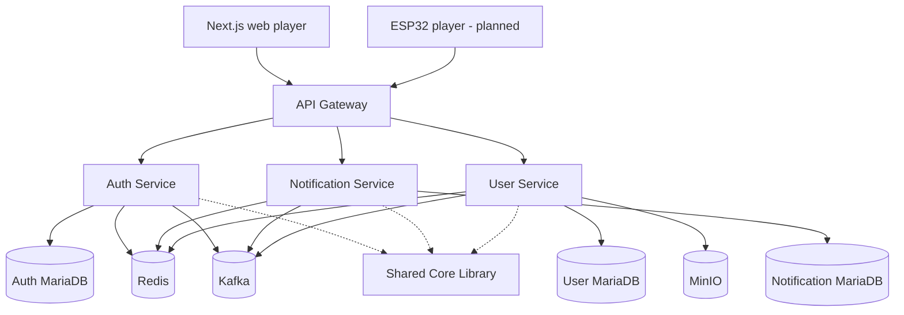

# BitRhythm

BitRhythm is a cloud-native music streaming platform designed for web clients
and custom embedded players such as the ESP32. It combines a Spring Boot
service-oriented backend with a Next.js music player frontend and shared local
infrastructure for authentication, notifications, storage, and messaging.

## Architecture

BitRhythm uses independently deployable Spring Boot services with shared
infrastructure. This keeps domain boundaries explicit while allowing the
platform to evolve toward a larger distributed architecture.



### Backend modules

| Module | Responsibility |
| --- | --- |
| `backend/gateway` | Public API entry point, routing, JWT validation, CORS, rate limiting, retries, circuit breakers, and health endpoints |
| `backend/auth_service` | Registration, login, refresh and logout, password recovery, email verification, JWT signing/JWKS, RBAC, service tokens, and admin user operations |
| `backend/user_service` | User profiles, settings, avatars, follows, and follow-related outbox events; integration with the default stack is in progress |
| `backend/notification_service` | Email notifications, in-app inbox, Server-Sent Events, delivery logs, templates, resend operations, and dead-letter replay |
| `backend/core` | Shared Spring Boot library containing common web, validation, JPA, observability, and utility dependencies |
| `device/` | Reserved for the ESP32/embedded player implementation |
| `frontend/` | Next.js music player with playlists, favorites, genres, search, authentication, and audio playback UI |

### Infrastructure

- **MariaDB** stores service-owned relational data.
- **Redis** provides caching and short-lived state.
- **Kafka** transports asynchronous notification events.
- **MinIO** provides S3-compatible object storage for future audio and artwork
  delivery.
- **Mailpit** captures email locally without sending messages to real
  recipients.

## Implemented capabilities

### Authentication and security

- User registration, login, refresh-token rotation, logout, and logout-all.
- Email verification and password reset workflows.
- RS256 JWT access tokens with a JWKS endpoint.
- Role and permission management.
- Service-to-service token issuance and token introspection.
- Gateway-level JWT issuer, audience, role, CORS, and request-size controls.
- Per-client rate limiting for authentication and API routes.

### Notifications

- Kafka-backed notification commands.
- Localized email templates for verification and password workflows.
- Persistent in-app notification inbox.
- Real-time notification streaming.
- Administrative delivery logs, resend support, and dead-letter replay.

### Web player

The frontend in [`frontend/`](frontend/) is an actively developed Next.js
application. It includes the home page, genre and search views, library,
favorites, playlists, authentication screens, responsive navigation, themes,
and a persistent audio player. It currently uses PostgreSQL through Prisma and
can also be configured for SQLite during local development.

### Planned streaming workflows

The target media workflow is direct-to-object-storage delivery:

1. A client requests playback authorization for a track.
2. The streaming service generates a short-lived MinIO/S3 presigned URL.
3. The web client or ESP32 downloads audio directly from object storage.
4. HTTP range requests allow seeking and bounded-memory playback.

The backend should not proxy complete audio files through the JVM. On the
ESP32, playback is intended to use small chunks (for example, 32 KiB) while
audio is decoded and sent to an I2S DAC.

## Technology stack

- Java 21
- Spring Boot 4.1.x
- Spring Security and OAuth2 Resource Server
- Spring Data JPA
- MariaDB 11.4
- Redis 7.4
- Apache Kafka 3.9
- MinIO
- Docker Compose
- Maven
- Next.js 16.4 canary, React 19, TypeScript, Tailwind CSS, and Prisma 7
- ESP-IDF/C++ (planned embedded client)

## Prerequisites

- Docker Desktop with the Linux container engine enabled
- Docker Compose v2
- Java 21 and Maven, if running services outside Docker
- Node.js and pnpm 10, if running the frontend
- OpenSSL, if generating stable local JWT signing keys

## Quick start with Docker Compose

The recommended local setup is documented in
[`docker/DOCKER_SETUP.md`](docker/DOCKER_SETUP.md).

From PowerShell:

```powershell
cd D:\HUST\after_uni\BitRhythm\docker

Copy-Item .\env\auth.env.example .\env\auth.env
Copy-Item .\env\gateway.env.example .\env\gateway.env
Copy-Item .\env\minio.env.example .\env\minio.env
Copy-Item .\env\notification.env.example .\env\notification.env
Copy-Item .\env\redis.env.example .\env\redis.env
Copy-Item .\env\shared.env.example .\env\shared.env
Copy-Item .\env\.env.example .\env\.env

docker compose --env-file .\env\.env -f .\docker-compose.yml config
docker compose --env-file .\env\.env -f .\docker-compose.yml up -d --build
docker compose --env-file .\env\.env -f .\docker-compose.yml ps
```

Before starting the stack, replace every `change-me-*` value in the copied
environment files. Keep database credentials, JWT issuer values, JWT keys, and
`INTERNAL_API_KEY` consistent across services. Never commit populated
environment files or private keys.

### Local endpoints

| Component | Address |
| --- | --- |
| API Gateway | http://localhost:8080 |
| Auth Service | http://localhost:8081 |
| Notification Service | http://localhost:8084 |
| Mailpit inbox | http://localhost:8025 |
| MinIO API | http://localhost:9000 |
| MinIO console | http://localhost:9001 |
| Redis | `localhost:6379` |
| Kafka external listener | `localhost:9094` |
| Auth MariaDB | `localhost:3307` |
| Notification MariaDB | `localhost:3308` |

Health endpoints include:

```text
GET http://localhost:8080/health/liveness
GET http://localhost:8080/health/readiness
GET http://localhost:8081/health/live
GET http://localhost:8081/health/ready
GET http://localhost:8084/health/live
GET http://localhost:8084/health/ready
```

## Building and testing

Each backend service is an independent Maven project:

```powershell
cd D:\HUST\after_uni\BitRhythm\backend\core
.\mvnw.cmd test

cd D:\HUST\after_uni\BitRhythm\backend\auth_service
.\mvnw.cmd test

cd D:\HUST\after_uni\BitRhythm\backend\notification_service
.\mvnw.cmd test

cd D:\HUST\after_uni\BitRhythm\backend\user_service
.\mvnw.cmd test

cd D:\HUST\after_uni\BitRhythm\backend\gateway
.\mvnw.cmd test
```

Build an individual executable service with:

```powershell
.\mvnw.cmd clean package
```

The `core` module is a plain library JAR and is not a standalone service.

## API overview

The gateway exposes the public API under these route groups:

| Route group | Purpose |
| --- | --- |
| `/api/auth/**` | Authentication, account recovery, and verification |
| `/api/user/**` | User-facing service routes |
| `/api/admin/**` | Administrative operations |
| `/api/roles/**` and `/api/permissions/**` | RBAC management |
| `/api/token/**` | Service token operations |
| `/api/notifications/**` | Notification inbox and real-time stream |

Service-only endpoints such as JWKS, token introspection, and internal
notification publishing should not be exposed directly to public clients.

## Running the frontend

The frontend has its own setup and database workflow. See
[`frontend/README.md`](frontend/README.md) for the full feature and testing
documentation.

From PowerShell:

```powershell
cd D:\HUST\after_uni\BitRhythm\frontend
pnpm install
pnpm prisma.push
pnpm prisma.seed
pnpm dev
```

Set `DATABASE_URL` in `frontend\.env.local` before running Prisma commands.
The frontend's local development database is separate from the backend
service databases.

## User service status

The user service contains the first-stage profile, settings, avatar, and follow
features. Its standalone setup and integration notes are documented in
[`backend/user_service/README.md`](backend/user_service/README.md). The default
Compose stack currently starts the gateway, auth service, notification
service, and shared infrastructure; user-service integration is still being
completed.

## Repository layout

```text
BitRhythm/
├── backend/
│   ├── auth_service/          # Authentication and authorization service
│   ├── core/                  # Shared Java library
│   ├── gateway/               # Public API gateway
│   ├── notification_service/  # Email and in-app notifications
│   └── user_service/          # Profiles, settings, avatars, and follows
├── device/                    # Planned ESP32 player
├── docker/                    # Compose files, environment examples, and data
├── frontend/                  # Next.js web player
├── jitpack.yml                # Shared core publication configuration
└── README.md
```

## Development notes

- Containers communicate using Compose service names, not host loopback
  addresses. For example, services use `kafka:9092` and `redis:6379`.
- Empty JWT key values enable an ephemeral key pair for local development only;
  tokens become invalid after an auth-service restart.
- The default Compose stack persists database, Kafka, Redis, and MinIO data.
- `docker compose down -v` permanently removes named-volume data. Use it only
  when a full local reset is intended.
- Replace Mailpit with a real SMTP relay before using the notification service
  outside local development.

## Roadmap

- Add the music catalog domain: artists, albums, songs, metadata, and artwork.
- Add MinIO upload management and presigned playback URL generation.
- Connect the frontend player to backend catalog, playlist, favorite, and
  playback APIs.
- Complete user-service integration with the default Compose stack.
- Implement ESP32 device pairing, range-based streaming, decoding, and I2S
  output.
- Add production deployment, secret management, migrations, and scalable
  observability.

## License

The frontend is licensed under the [MIT License](frontend/LICENSE). No license
has been declared for the backend and repository root yet.
